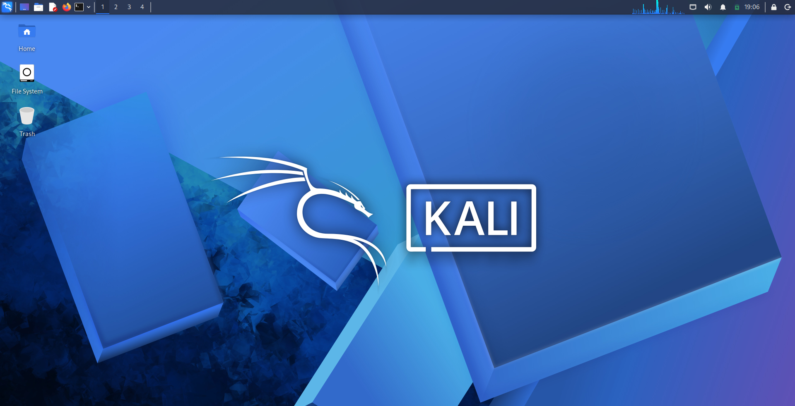
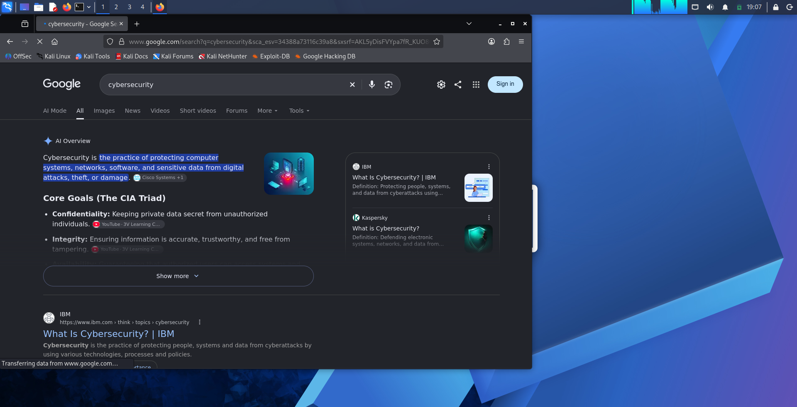
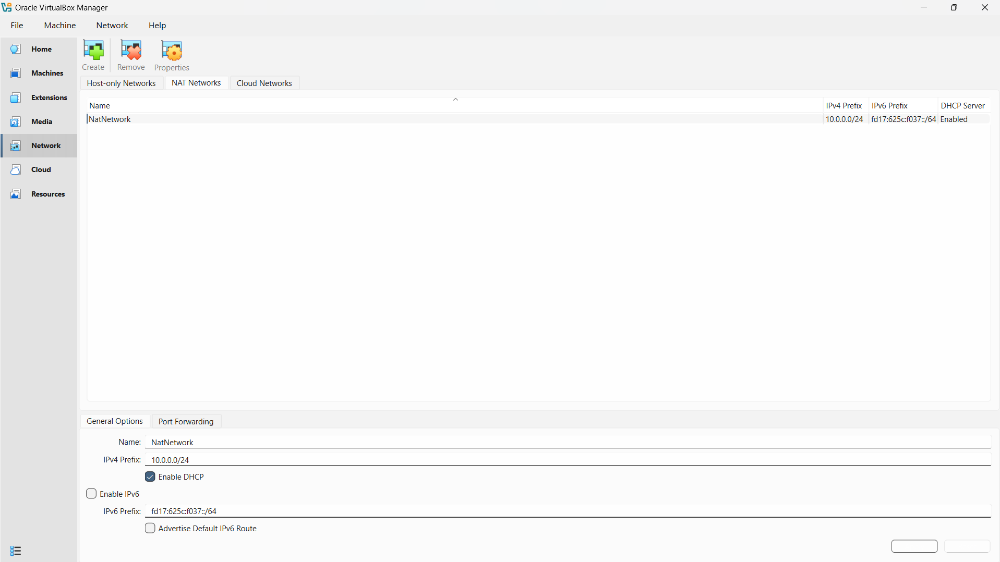
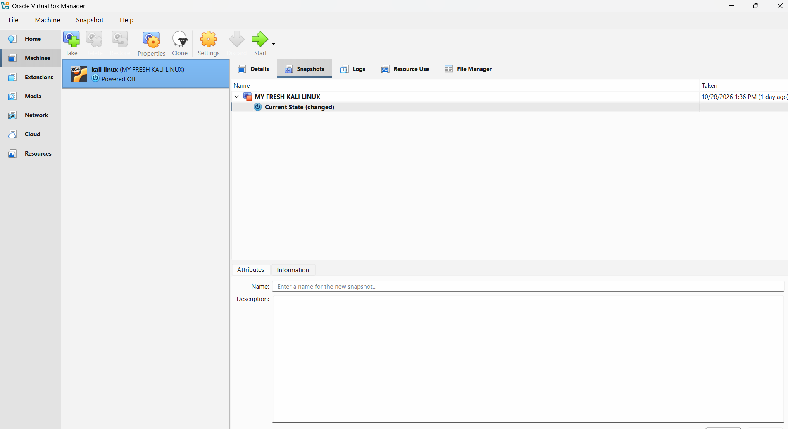

# Week 01: Cybersecurity & Penetration-Testing Lab Setup

## Project Overview

This project documents the setup of a virtual cybersecurity and
penetration-testing lab using Oracle VirtualBox and Kali Linux as part
of the **Cybersecurity Professional Program at NETWORKWALKS**, under the
guidance of **Waqas Karim (CCIE)**.

The goal was to prepare a working Kali Linux environment for future
cybersecurity practice, with a dedicated VirtualBox NAT Network,
internet connectivity, and a recovery snapshot.

## Objectives

-   Install and configure Oracle VirtualBox.
-   Set up Kali Linux as the lab's penetration-testing machine.
-   Create a VirtualBox NAT Network using the `10.0.0.0/24` subnet.
-   Configure and verify Kali Linux network connectivity.
-   Confirm internet access and browser connectivity.
-   Test that Nmap is installed.
-   Create a baseline virtual-machine snapshot.
-   Capture screenshots documenting the completed setup.


## Lab Environment

| Component | Configuration |
|---|---|
| Virtualization Platform | Oracle VirtualBox |
| Guest Operating System | Kali Linux 2026.2 |
| Virtual Network | `NatNetwork` |
| Network Type | NAT Network |
| IPv4 Network | `10.0.0.0/24` |
| DHCP | Enabled |
| Lab Machine Role | Penetration-testing machine |


> **Network note:** The VirtualBox NAT Network configuration is shown in
> the screenshots. Record the Kali VM's actual IP address, gateway, and
> DNS values from your own terminal output if you want to include them
> here.

## Setup Process

### 1. Install Oracle VirtualBox

Installed and opened Oracle VirtualBox to create and manage the Kali
Linux virtual machine.

### 2. Set Up Kali Linux

Started the Kali Linux virtual machine and confirmed that the desktop
environment loaded successfully.

### 3. Configure the NAT Network

Created a VirtualBox NAT Network named `NatNetwork` with the IPv4 prefix
`10.0.0.0/24`. DHCP was enabled in the VirtualBox network settings.

A NAT Network provides a virtual network for connected VMs and allows
them to access external networks through network address translation. It
can also support communication between virtual machines attached to the
same NAT Network.

### 4. Verify Connectivity

Opened Firefox in Kali Linux and accessed Google to confirm that the
browser had internet connectivity.

For command-line verification, the following commands can be used:

``` bash
ip -br address
ip route
cat /etc/resolv.conf
ping -c 4 8.8.8.8
ping -c 4 google.com
nmap --version
```

These commands display the network interface addresses, routing table,
DNS configuration, test connectivity, and check the installed Nmap
version. Use the actual command output when documenting the results.

### 5. Create a Baseline Snapshot

Created a VirtualBox snapshot named **MY FRESH KALI LINUX**. This
provides a restore point for returning to the initial lab state before
later experiments.

## Verification Summary

-   [x] Oracle VirtualBox opened successfully.
-   [x] Kali Linux desktop started successfully.
-   [x] `NatNetwork` created with IPv4 prefix `10.0.0.0/24`.
-   [x] DHCP enabled for the NAT Network.
-   [x] Internet access verified through Firefox.
-   [x] Baseline VM snapshot created.
-   [x] Screenshots captured for documentation.

Nmap installation was part of the planned checks; include its version
output or a screenshot if you want to document that verification
explicitly.


## Screenshots

### 1. Kali Linux Desktop

Kali Linux running inside Oracle VirtualBox.

<p align="center">
  
</p>

### 2. Internet Connectivity

Firefox accessing Google from Kali Linux.

<p align="center">
  
</p>

### 3. NAT Network Configuration

VirtualBox NAT Network configured with the `10.0.0.0/24` IPv4 prefix and DHCP enabled.

<p align="center">
  
</p>

### 4. Baseline Snapshot

VirtualBox snapshot named `MY FRESH KALI LINUX`.

<p align="center">
  
</p>

## What I Learned

This lab provided practical experience with:

-   Using VirtualBox to run a dedicated cybersecurity operating system.
-   Configuring a NAT Network and understanding its role in virtual lab
    networking.
-   Checking basic connectivity from Kali Linux.
-   Keeping a baseline snapshot so the VM can be restored before future
    exercises.
-   Capturing evidence and documenting a technical setup clearly.

## Ethical and Legal Use

This environment is intended for learning and authorized security
testing. Only test systems and networks that you own or have explicit
permission to assess.

## Acknowledgement

Thank you to **Waqas Karim (CCIE)** for conducting the practical session
and guiding the setup, and to the **NETWORKWALKS** team for the learning
opportunity and support.

## Author

**Kelvin Arigbe**

Cybersecurity Professional Program --- Week 01
